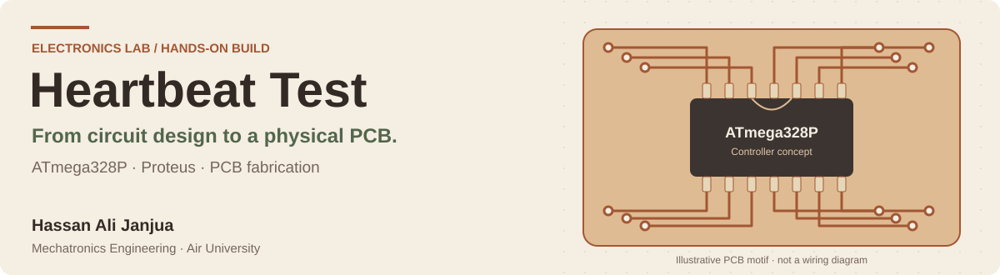
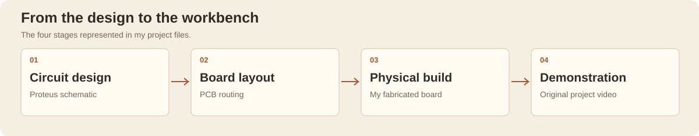
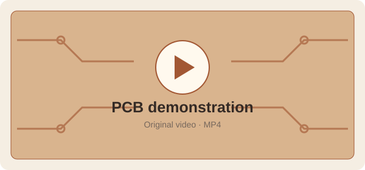

# Heartbeat Test — Electronics & PCB Project

**Hassan Ali Janjua · Mechatronics Engineering · Air University, Islamabad**

[My approach](#from-the-design-to-the-workbench) · [My PCB](#my-physical-pcb) · [Demonstration](#project-demonstration) · [Proteus project](Hearbeat%20Test.pdsprj) · [Project report](Project%20Report.pdf)

## A project I built with my own hands

I wanted to take an electronics design beyond the screen and turn it into a physical circuit. My Heartbeat Test project gave me the opportunity to work with a microcontroller-based circuit, design its printed circuit board and work on the hardware myself.

What makes this project particularly important to me is the hands-on part. I did the practical work myself, rather than stopping at a simulation. Seeing the PCB take shape from the design was one of the most satisfying parts of the project.

This repository brings together my Proteus design, the photograph of my fabricated PCB, a demonstration recording and the original project report.

## My physical PCB

  
   <em>The physical PCB I worked on — original project photograph.</em>

The photograph shows the board at the fabrication stage, with the conductive tracks, component pads and drilled holes visible. I wanted to preserve this part of the build because it shows the physical work behind the electronics design.

## From the design to the workbench

### 01 / Circuit design in Proteus

I started with the electronics design in Proteus. The project is based on the ATmega328P microcontroller, which is the main controller identified in my project description. The Proteus project contains the schematic and the PCB layout.

[Open the original Proteus design](Hearbeat%20Test.pdsprj)

### 02 / PCB layout

Once the circuit design was in place, I worked on translating it into a physical board layout. For me, this was the point where the electrical connections had to become real tracks and component positions rather than just lines on a schematic.

The Proteus project archive contains both `ROOT.DSN` (schematic) and `ROOT.LYT` (PCB layout).

### 03 / Hardware implementation

I worked on the PCB myself. The original photograph shows the result at the bare-board stage, including the routed tracks and through-holes. I kept the original photo and recording here to document the actual hardware work.

### 04 / Demonstrating the project

I recorded a video of the project and kept it alongside the design and report so the practical work can be explored directly.

## Project demonstration

<table>
<tr>
<td width="48%" align="center">

</td>
<td width="52%" valign="top">

<b>My original PCB demonstration</b>

  
A recording from the project, kept in its original format.

  
<a href="PCB%20Video.mp4"><b>Watch or download the video →</b></a>

  
<a href="Project%20Report.pdf">Read my project report →</a>

</td>
</tr>
</table>

GitHub may open the video file page or offer a download instead of playing it inside the README.

## What I learned from building it

Working on the circuit and PCB helped me connect the electronics theory I had studied with the practical side of building hardware. The design has to make sense electrically, but it also has to be possible to turn it into a real board.

| Area | Project experience |
| --- | --- |
| Electronics design | Working with a microcontroller-based circuit |
| PCB design | Translating electrical connections into a board layout |
| Practical electronics | Working on the physical PCB and inspecting the tracks and holes |
| Engineering documentation | Keeping the design file, photograph, recording and report together |

## Explore the project files

| File | What's inside |
| --- | --- |
| [Hearbeat Test.pdsprj](Hearbeat%20Test.pdsprj) | Original Proteus project, schematic and PCB layout |
| [PCB.jpg](PCB.jpg) | My original physical board photograph |
| [PCB Video.mp4](PCB%20Video.mp4) | Original project demonstration |
| [Project Report.pdf](Project%20Report.pdf) | Original academic project report |
| [Technical notes](docs/project-notes.md) | File structure, design review and scope |

<b>How to open the design in Proteus</b>

Download the original `Hearbeat Test.pdsprj` file and open it using a compatible Proteus installation. Inspect the schematic and PCB layout in the application. Review the report for the component details and testing context before reproducing the circuit.

The project archive contains design files, but no separately published microcontroller firmware source is included in this repository. Do not assume the schematic is ready for fabrication or programming without reviewing it.

## Project scope

This is an academic electronics prototype. I have not claimed a verified heart-rate accuracy, calibration result or clinical performance. It is not a validated medical device and should not be used for diagnosis or medical decisions.

---

**Hassan Ali Janjua**  
Mechatronics Engineering · Embedded Electronics · PCB Design

[My engineering portfolio](https://github.com/HassanAliJanjua03)

