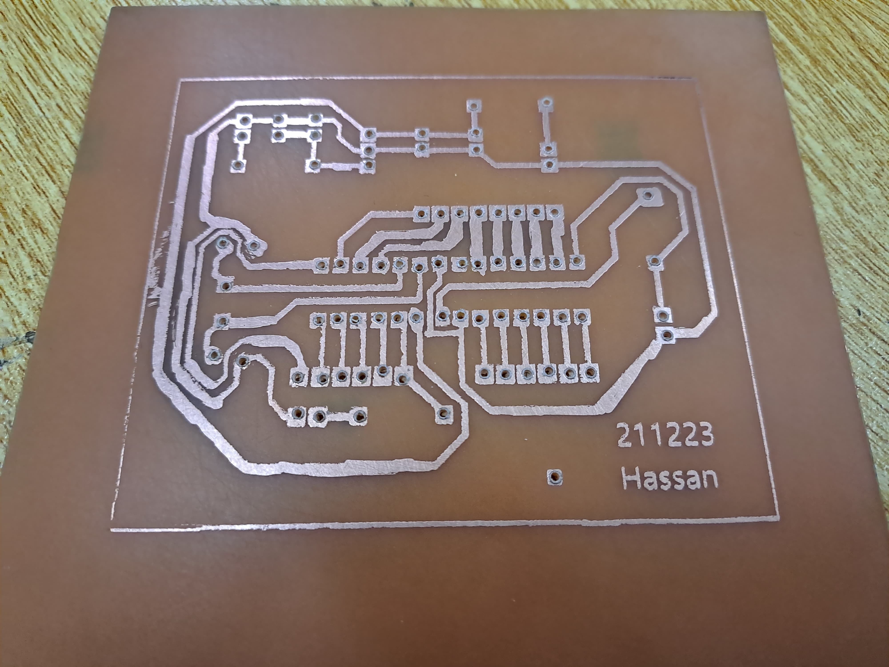

# Heartbeat Test — Electronics and PCB Project

**Electronics · Proteus · PCB**

An academic heartbeat-test electronics project containing a Proteus design, PCB photograph, demonstration video and report.

## Engineering highlights

- Circuit design project in Proteus format.
- PCB photograph and video documenting the hardware project.
- Engineering report for the design and testing context.

## Project files

| File | Purpose |
| --- | --- |
| [Hearbeat Test.pdsprj](Hearbeat%20Test.pdsprj) | Original source or design file |
| [PCB.jpg](PCB.jpg) | Original source or design file |
| [PCB Video.mp4](PCB%20Video.mp4) | Original source or design file |
| [Project Report.pdf](Project%20Report.pdf) | Original source or design file |

## How to explore or reproduce

Open `Hearbeat Test.pdsprj` in a compatible Proteus installation and consult the report. The video provides additional project context.

## Scope and limitations

This is an academic electronics prototype, not a validated medical device. Accuracy and clinical suitability are not established by this repository.

## Portfolio

[Hassan Ali Janjua — Engineering portfolio](https://github.com/HassanAliJanjua03)
